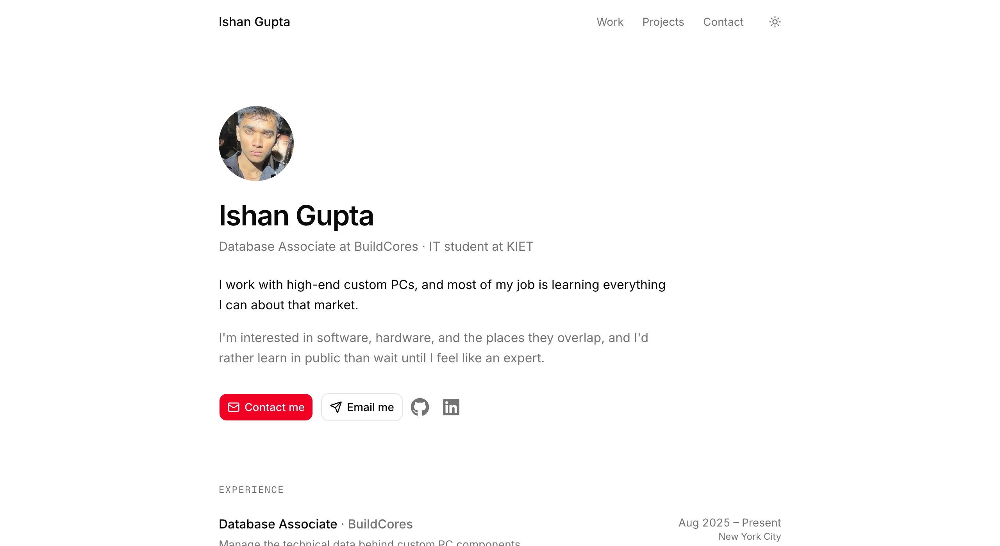

# ishan-portfolio

My personal site: **[ishan-portfolio-xi-sage.vercel.app](https://ishan-portfolio-xi-sage.vercel.app)**



One page covering my experience, education, AWS certifications and projects:

- **Deploy AI**: an F1 session explorer. [Live](https://deploy-ai-f1-ishan14-7s-projects.vercel.app/) · [Code](https://github.com/ishan14-7/deploy-ai-f1)
- **GraphRCA**: graph-powered root-cause analysis on FalkorDB. I designed the frontend. [Live](https://axon.aadijain.dev) · [Code](https://github.com/aadijaiin/GraphRCA)

## Stack

Next.js 16 (App Router), React 19, Tailwind CSS 4, shadcn/ui on Base UI, `next-themes` for light and dark mode, `lucide-react` and `react-icons` for icons. Hover and press effects are plain CSS, and they turn off when the device asks for reduced motion.

## Editing content

Everything on the page lives in [`src/app/page.tsx`](src/app/page.tsx) as plain arrays, so most updates are a one-line edit:

| Array            | What it holds                                      |
| ---------------- | -------------------------------------------------- |
| `experience`     | Role, company, dates, location, one-line summary   |
| `education`      | School, degree, years                              |
| `certifications` | Certification names                                |
| `projects`       | Name, summary, live URL, repo URL, screenshot, role |
| `profiles`       | GitHub and LinkedIn links shown in the intro       |

Project screenshots go in `public/` at 2560×1600 (a 1280×800 window at 2×). When you replace an image, give it a new filename, because Next.js caches optimised images by path.

```
src/
├── app/
│   ├── layout.tsx            # fonts, metadata, theme provider
│   ├── page.tsx              # the whole page and its content
│   └── globals.css           # theme tokens (light and dark)
├── components/
│   ├── copy-email-button.tsx # copies the email and shows a check
│   ├── theme-toggle.tsx
│   └── ui/button.tsx         # shadcn button
└── lib/utils.ts              # cn() and the shared hover/press classes
```

## Running locally

```bash
npm install
npm run dev     # http://localhost:3000
npm run lint
npm run build
```

Fonts (Inter and Geist Mono) come from Google Fonts through `next/font`, so `npm run build` needs network access.

## Deploying

Vercel deploys every push to `master`.
